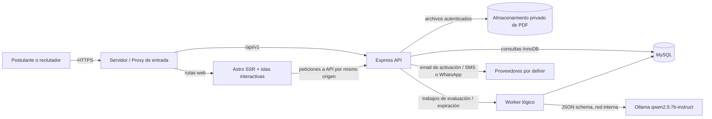

# 01 · Arquitectura del sistema — propuesta Fase 4

## Objetivo y límites

Diseñar **Qori Talento** sobre las tecnologías comprometidas: `frontend/` en Astro + Tailwind/Flowbite, `backend/` en Node.js + Express, MySQL y un motor local de IA Ollama para RSF23/24. El documento original conserva ocho módulos: (1) Usuarios, (2) Ofertas, (3) Postulación, (4) CV, (5) Exámenes, (6) Evaluación, (7) Resultados/Selección, (8) Seguimiento.

Se propone un **monolito modular** con un solo servicio backend al inicio: evita microservicios, simplifica transacciones y es adecuado para desarrollo académico. Un worker lógico puede ejecutarse dentro de un proceso separado del mismo repositorio cuando las evaluaciones IA/expiración requieran desacoplamiento. La división en microservicios no forma parte del MVP.

## Contenedores lógicos



**Barrera de confianza:** el navegador y el contenido de los CV son entradas no confiables; Express valida identidad/rol/propiedad y payload. **Ollama nunca es invocado directamente desde Astro/navegador.** MySQL y el repositorio de PDF no están expuestos públicamente. En pruebas locales el mismo equipo puede ejecutar todos los procesos; ello **no** implica capacidad de producción ni concurrencia garantizada.

## Frontend propuesto

- Páginas Astro para shell, navegación, ofertas, formularios y resultados; rendering bajo demanda (SSR) para vistas personalizadas y sesiones. Páginas promocionales pueden ser estáticas.
- Islas JavaScript solo donde agregan valor: formulario de oferta, carga PDF, editor de preguntas, tabla de comparación y examen/temporizador. No imponer React/Vue sin benchmark de complejidad: primera alternativa es JavaScript/TypeScript nativo en Astro; framework de islas pendiente si resulta necesario.
- Tailwind y Flowbite como base; tokens Qori Sky, Inter, Light/Dark; componentes reutilizables y cinco estados operativos por región: Ideal, Vacío, Parcial, Carga, Error. La navegación lateral NO muestra una opción «Estados de UI».
- Para evitar CORS y exposición de tokens, proponer un **origen HTTPS común**: `/`→Astro, `/api/v1`→Express. En desarrollo, proxy de API o puertos separados estrictamente configurados.
- Fuente real de verdad siempre en API, no en Figma ni en datos de ejemplo de Astro.

## Backend: módulos y capas

```text
backend/src/
  app/                   # configuración, composición, middleware (propuesto)
  modules/
    identity/            # acceso, perfiles, verificación, propiedad
    jobs/                # ofertas, requisitos, moderación y cuota
    applications/        # postular, asociar CV, seguimiento básico
    cv/                  # extracción clásica, revisión y versiones
    exams/               # preguntas, intentos, guardado, expiración
    evaluation/          # nota objetiva, adaptador IA, evidencias
    selection/           # decisiones humanas y auditoría
    tracking/            # historial y consultas autorizadas
  shared/
    auth/ validation/ errors/ persistence/ events/ logging/
  workers/               # expiración y evaluación asincrónica
```

Cada dominio propone rutas→controladores→casos de uso/servicios→repositorios. Validación, auditoría y autorización son transversales; no se permite consulta directa a MySQL desde la capa HTTP sin política de acceso. Express dispone de middleware por aplicación/router y gestión de errores para esto.

## Composición de servicios

1. Astro solicita/edita datos mediante `/api/v1` y representa estados UI.
2. Express autentica, comprueba que el usuario está activo, valida payload, verifica rol y propiedad por **creador de la oferta**, después ejecuta reglas/consulta MySQL.
3. Un flujo de CV valida PDF y almacena archivo fuera de `public`; el extractor clásico sugiere campos que confirma el postulante.
4. Los exámenes usan el reloj oficial de servidor/base de datos y guardado por pregunta; todas las operaciones deben resistir la recarga/duplicación/concurrencia.
5. El worker de evaluación prepara un paquete limitado de evidencias confirmadas (CV, requisitos de oferta, nota objetiva), invoca Ollama y valida esquema/evidencias antes de persistir una sugerencia de puntuación.
6. La decisión «Avanza/No avanza» es ejecutada y auditada **solo por reclutador autorizado**; ningún resultado IA cambia ese estado automáticamente.

## Fuera del alcance actual

- Código o contratos definitivos de servicios; tablas físicas y ORM elegidos; despliegue a nube; integraciones verificadas con proveedores SMS/WhatsApp; OCR/PDF escaneados; búsqueda semántica con embeddings; moderación administrada sin autor definido; automatización de contratación.

## Decisiones de escalabilidad y sostenibilidad

- Al inicio, un proceso Express más un proceso worker es suficiente **como propuesta**; separar cuando se justifique por mediciones.
- Almacenar PDF en soporte privado distinto al webroot; registrar metadatos y referencias en MySQL, no contenido binario en columnas de texto.
- Usar índices por propietario y referencias FK, paginar listados, evitar N+1, incluir filtrado desde consulta SQL.
- En producción, reevaluar si Ollama puede ejecutarse con GPU dedicada; 8GB VRAM del equipo del usuario son adecuados para **pruebas iniciales**, no una promesa de latencia/volumen.

**Referencias técnicas verificadas:** [Astro rendering](https://docs.astro.build/en/guides/on-demand-rendering/), [Astro islands](https://docs.astro.build/en/concepts/islands/), [middleware Express](https://expressjs.com/en/guide/using-middleware/).
