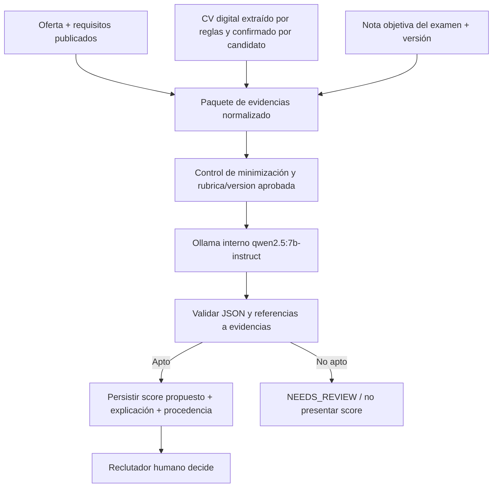

# 06 · Evaluación asistida por IA con Ollama — propuesta Fase 4

## Qué aprobó el usuario y qué NO

**Aprobado:** la IA **propone el puntaje final y una explicación breve** como apoyo a decisión humana; se optó por **Ollama local** y por probar primero el modelo ya instalado `qwen2.5:7b-instruct` (modelo concreto respaldado por el equipo del usuario: 16 GB RAM/8 GB gráfica). Extracción del PDF sigue siendo **clásica**, sin IA generativa para parser. `nomic-embed-text` permanece instalado pero **NO es dependencia del MVP**, y `qwen2.5-coder:7b` se reserva para asistencia de programación, no evaluación.

**PENDIENTE:** definición de rúbrica, escala/ponderaciones, cómo se mezclan CV y nota de examen, umbrales Alta/Media/Baja, métricas de calidad y sesgo, política ante falta de evidencia, revisión/impugnación y exposición al candidato. Por tanto se permite **experimentar con datos ficticios**, pero NO producir ranking real para contratación hasta validar lo anterior.

## Pipeline y límites de confianza



**Nunca enviar por defecto:** contraseñas, teléfonos/correos si no son necesarios, documentos de identidad, foto, edad, género, religión, datos de salud u otros atributos personales no pertinentes. La información extraída de CV se trata como datos **no confiables**, nunca como instrucciones del sistema.

## Adaptador IA propuesto

- Servicio interno `AiEvaluationService` del backend/worker: genera paquete de entrada, aplica límites de tamaño, marca prompt/rúbrica/modelo, llama a Ollama en `http://127.0.0.1:11434/api/chat` o red interna.
- Modelo parametrizado `qwen2.5:7b-instruct`; `stream:false`; `format` JSON Schema; temperatura baja como *ayuda* a reproducibilidad, **no garantía** de determinismo.
- Validación estricta del JSON contra esquema también en Express; no aceptar texto libre como JSON válido; chequear que referencias `criterion_id`/`source_ref` existen y corresponden al caso, y que no se citan criterios irrelevantes o inexistentes.
- Estado `PENDING → READY | NEEDS_REVIEW | FAILED`; reintentos limitados, timeout y cola para que la latencia IA no bloquee listados normales.
- `READY` requiere puntaje respaldado, no solo JSON bien formado. Si evidencia insuficiente, devolver `NEEDS_REVIEW`, explicitar incertidumbre y no inventar un porcentaje.
- Persistir versión de modelo, digest/config, versión de rúbrica y prompt, snapshot de entrada referenciado, fecha, score propuesto, explicación, evidencias y revisión humana. Re-evaluaciones crean nueva fila, sin sobrescribir resultados/decisiones previos.

## Contrato de respuesta JSON conceptual

```json
{
  "status": "READY",
  "proposed_final_score": 82,
  "scale_max": 100,
  "brief_explanation": "Experiencia comprobable en tecnologías solicitadas; no se identificó evidencia de pruebas automatizadas.",
  "evidence": [
    {"criterion_id": "C-01", "source_ref": "profile_version:…", "finding": "Menciona experiencia en React"}
  ],
  "missing_evidence": ["C-04"],
  "human_decision_required": true
}
```

**Este objeto es ilustrativo con perfil sintético; 82 NO es una ponderación ni resultado real.** En caso `NEEDS_REVIEW` o fallo, `proposed_final_score=null`. El backend nunca acepta `human_decision_required:false` desde el modelo.

## Evaluación responsable y pruebas antes de producción

1. Construir conjunto **sintético** de ofertas, CV y exámenes con criterios explícitos; incluir CV incompletos, ambigüedad, experiencia equivalente, formatos diferentes y CV adversariales.
2. Establecer rúbrica aprobada y resultados de referencia redactados por personas conocedoras del dominio. Comparar IA con referencia; medir variación entre repeticiones y coherencia textual de evidencias.
3. Ensayar consistencia contrafactual: cambiar información irrelevante/protegida sin cambiar experiencia laboral y observar si se modifica puntuación. La puntuación no debe depender de atributos no laborales.
4. Detectar alucinaciones: cita inexistente → `NEEDS_REVIEW`; salida no valida → `FAILED`; falta de evidencia nunca equivale automáticamente a falta de habilidad.
5. Probar prompt injection incorporado al texto extraído del CV; no ejecutar instrucciones contenidas en CV.
6. Mantener supervisión humana, posibilidad de revisar evidencia y prohibición de descarte automático. Definir quién puede solicitar reevaluación y qué sucede si cambia CV.
7. Medir tiempo en hardware real; si no cabe en expectativas de 3 segundos de APIs normales, usar `202`/estado `PENDING`, mostrar UI Parcial/Carga y completar fuera del ciclo de petición.

## Decisión de scoring aún abierta

La IA **es el componente que formula** el puntaje orientativo, no un simple formateador de una nota prefijada. Pero deberá operar con instrucciones/rúbrica aprobadas, límites de escala y evidencias trazables. Fijar pesos arbitrarios en esta fase contradice el proceso SDD. Puede estudiarse el modo de obtener el nivel de compatibilidad a partir del score, pero umbrales siguen bloqueados.

## Riesgos de despliegue

Cero tarifa por llamada en Ollama local **no** significa producción gratuita: GPU/energía/disponibilidad y monitoreo. No exponer puerto Ollama, y no enviar CV de usuarios reales a terceros mientras no exista política de tratamiento de datos aprobada.

Referencia oficial: [API chat Ollama](https://docs.ollama.com/api/chat) y [Structured Outputs](https://docs.ollama.com/capabilities/structured-outputs).
